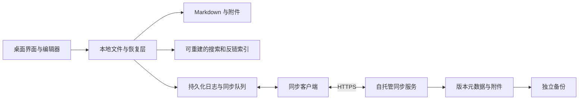

# LeafVault 架构方案

日期：2026-10-20。状态：候选设计，尚无实现或性能验证。

架构围绕三个约束展开：Markdown 文件是用户可直接使用的内容；本地编辑不依赖服务器；任何索引或同步故障都应有明确的恢复路径。

## 1 候选技术栈

| 部分 | 初始选择 | 理由与验证条件 |
| --- | --- | --- |
| 桌面外壳 | Tauri 2 | 使用系统 WebView；先验证中文输入、文件权限、剪贴板及实际包体与内存 |
| 界面 | React + TypeScript + Vite | 组件化构建桌面界面，首版无需服务端渲染 |
| 编辑器 | CodeMirror 6 | 以文本为基础做 Markdown 编辑、即时预览与快捷键；实际体验由 M1 验证 |
| 本地文件层 | Rust | 统一处理安全路径、写入日志、文件监听及恢复 |
| 搜索与反链 | SQLite + FTS5 候选方案 | 索引派生自文件；中文短词检索需要专门实验 |
| 同步服务 | Rust + Axum + SQLite + 本地附件存储 | 与桌面文件层共用部分数据类型，减少语言种类；框架和版本在实施前核验 |
| 部署 | 单个应用容器，持久化数据卷 | 单用户、多设备、单节点；HTTPS 由反向代理处理 |

Tauri 在不同平台使用不同 WebView，因此 macOS 上通过不代表 Windows/Linux 通过。[Tauri 概览](https://v2.tauri.app/start/)、[WebView 文档](https://v2.tauri.app/reference/webview-versions/)

如果 M1 中 Tauri 的输入或无障碍问题无法在限定实验内解决，使用同一组样例评估 Electron，再记录取舍。包体积与内存优势需要实际构建测量。

CodeMirror 的 GitHub 开发仓库已标明迁往新的上游地址；实施时从当前上游与包注册表核实版本、维护状态和许可，不把旧仓库归档等同于项目停止维护。[迁移说明](https://github.com/codemirror/dev)、[当前上游](https://code.haverbeke.berlin/codemirror/dev)

## 2 模块关系

以下为目标结构，不代表已经存在这些组件。

首版采用一个仓库组织客户端、共享核心、协议和服务端。到实施阶段才创建相应源码目录，不预先生成无法运行的应用骨架。

## 3 数据与状态的边界

| 数据 | 是否可重建 | 丢失后的处理 |
| --- | --- | --- |
| Markdown 正文与原始附件 | 不可假定可重建 | 从用户备份或已确认的历史版本恢复 |
| 搜索、标签、大纲和反链索引 | 可由当前文件重建 | 删除损坏索引后重新扫描 |
| 同步对象 ID、基线版本、待发操作与游标 | 不能当作普通缓存 | 进入设备重新连接与对账流程，不能直接清空后批量上传 |
| 本地恢复日志与历史内容 | 具有恢复价值 | 保留并验证；清理遵循明确的历史策略 |
| 服务凭据 | 不可从笔记重建 | 使用系统安全存储；重新配对 |

正文放在用户选择的文件夹，应用状态拟放在该库的 `.leafvault/` 内。凭据不写入此目录。`.leafvault/` 不参与笔记文件同步；不要用通用同步工具复制其中的活动数据库。

使用其他编辑器修改正文属于支持目标。让多个应用实例或多个同步引擎同时写入同一份库，不属于首版保证：LeafVault 实例应通过锁防止并发写入；启用内置同步时提示避免叠加其他同步引擎。库的可移植性不等于任意并发写入都安全。

## 4 文件写入与崩溃恢复

文件系统与 SQLite 之间没有天然的跨存储原子事务。计划采用可恢复的操作日志，而不把一次重命名视作整个保存过程已经原子完成。

1. 读取当前文件哈希和编辑基线，发现外部变化时先进入冲突流程。
2. 将待写内容和操作意图写入持久化日志，校验成功后准备替换目标文件。
3. 在同一文件系统内写临时文件并完成必要的持久化，再替换目标；具体系统行为在 M1 验证。
4. 提交本地版本与待同步操作。若期间崩溃，启动时按日志和内容哈希幂等补全。
5. 本地内容与恢复信息达到约定持久化点后，界面才显示“已保存”。服务端确认另行更新同步状态。

文件监听器只提供变化提示；重新聚焦、重连及定期校验要补偿漏掉的事件。收到重复事件或应用自身写入事件，不应形成重复操作与无限循环。

保留原有换行、BOM 和未编辑区域，避免完整解析再序列化造成不必要改写。索引更新失败不应导致已保存正文回滚或消失。

## 5 Markdown 与迁移范围

| 内容 | 首版计划 |
| --- | --- |
| 常用 Markdown、任务列表、代码块、表格 | 编辑并渲染，保留源码模式 |
| YAML frontmatter | 读取常用字段，未知字段和原始排版保留；首版不自动重写整个属性区 |
| `[[note]]`、路径链接、显示别名、标题锚点 | 实现并提供精确的解析和歧义测试 |
| Markdown 图片、常见图片嵌入 | 支持；附件采用相对路径 |
| 重命名笔记 | 更新确定指向目标的引用，先显示影响范围；多文件修改用日志保证可恢复 |
| 块引用、笔记嵌入、公式、Callout | 首版保留源码；渲染能力按样例逐项决定并公开支持表 |
| Dataview、第三方插件、主题和 Canvas | 不执行、不改写；迁移报告说明 |
| `.obsidian/` 配置 | 不修改，不自动执行其中的脚本 |

重命名只改解析器确认的链接，不对全库执行简单字符串替换；代码块和普通文字中的同名内容不应被改动。同名文件不能只按标题猜测目标。

迁移报告必须列出不支持项和歧义。首次打开只扫描时哈希不变；编辑后应能继续被普通 Markdown 编辑器读取。双应用交替使用的样例需单独验证。

## 6 搜索策略

SQLite FTS5 提供全文索引与多种分词能力，但不能直接推断其默认设置满足中文搜索。特别是 trigram 的短查询限制，需要与中文单字、双字、连续长句和中英混合样例一起测量。[FTS5 文档](https://www.sqlite.org/fts5.html)

M1 对比默认分词、trigram 加短词回退及中文分词候选；按正确性、索引开销和响应时间决定。首版优先精确找到用户输入的词，不加入语义搜索或模型依赖。

索引在后台增量构建。首次扫描可显示进度，但不应阻止创建和编辑笔记。查询中途取消或快速切换查询时，旧结果不能覆盖新结果。

## 7 应用边界

- Markdown、HTML、SVG 与导入附件按不可信内容处理，阅读笔记不得执行任意脚本。
- 文件操作限制在明确选择的库内；不跟随指向库外的符号链接，不接受路径穿越。
- 远程图片默认不自动加载，用户可选择加载；本地附件无需网络。
- 不把任意 shell 能力暴露给笔记内容或界面脚本。
- 日志不记录正文、令牌或完整私人路径；诊断导出先让用户检查。
- 未来插件另行设计权限、分发和隔离机制，首版不提前开放不受约束的执行入口。

## 8 实施前需要形成的决定

M1 应交付编辑器与平台选择、支持的文件系统条件、中文搜索方案、保存持久化点及兼容样例清单。M3 应交付版本化同步协议、冲突规则与恢复实验结果。具体依赖版本只有在开始实现并完成许可核对后锁定。
